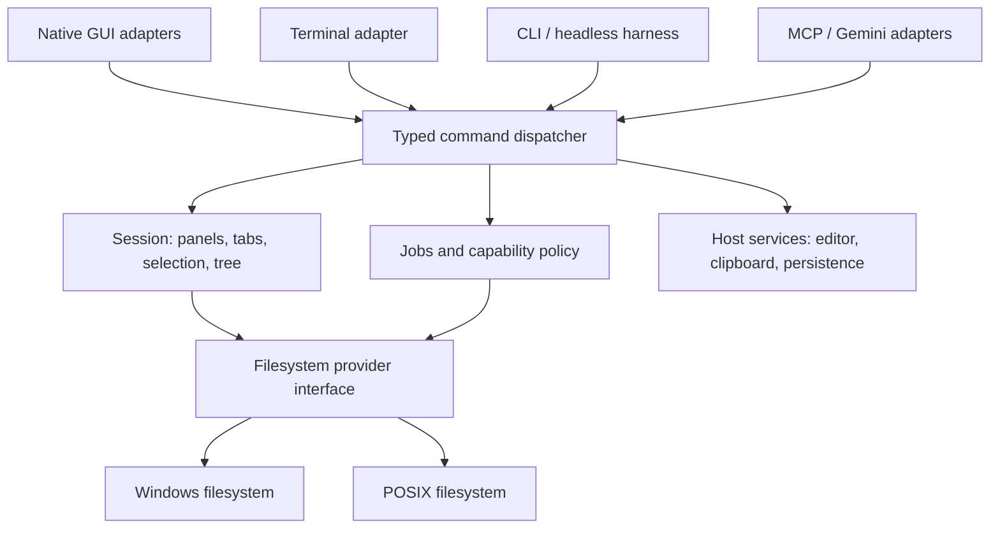

# aicmd design specification

Version 0.2 — 2026-09-21 — implementation baseline, revised to the user's Total Commander screenshot and Midnight Commander workflow.

User-directed constraints: compact full-width file panels; keyboard first; no persistent directory trees or oversized buttons. Linux validation uses `ssh ai` under `/data/devel/`, never WSL. Work is tracked in local Git; GitHub remote is git@github.com:juricap/aicmd.git.

## 1. Product and scope

Build a small, fast Total Commander-style file manager whose filesystem behavior is identical whether driven by a Windows/macOS/Linux GUI, a terminal over SSH, or a model tool call. Use jptxt for desktop text editing and, after a small integration extension, read-only viewing.

Priority order: responsive browsing; predictable keyboard operation; small native distribution; shared behavior; richer file operations and model integrations.

**M1 is Windows directory browsing and tabs.** It includes a real shared core and a headless command harness to establish the boundary early. It does not require a working TUI, cloud model connection, remote filesystem provider, or file mutation engine. Those are later milestones, not claims about the initial release.

## 2. Technology decisions

| Area | Decision | Reason / cost |
|---|---|---|
| Language | C++17; Objective-C++ only for Cocoa | Matches jptxt, direct OS calls, one toolchain family. Rust remains viable but adds no necessary benefit for this baseline. |
| Build | CMake; MSVC x64 first; static CRT | Mirrors jptxt. Separate core/test targets must build without any GUI dependencies. |
| Windows UI | Win32, common controls, GDI where needed | Virtual report ListView, compact TabControl, narrow path bar with inline edit, central splitter, small status/footer. |
| macOS UI | Cocoa adapter | Native outline/table/tab presentation; shares state, not pixels. |
| Linux UI | X11 baseline, following jptxt | Native Wayland support is a separate backend; initial Wayland desktops require XWayland. |
| Terminal | VT rendering + POSIX termios; Windows console adapter later | Runs on the SSH host without a display server. Capability detection and minimal-color fallback. |
| Tools | Typed command registry, JSON Schema, MCP stdio, Gemini adapter | No model SDK or networking dependency inside core. |
| JSON | One pinned, reviewed C++ JSON library in serialization targets | Do not handwrite a general JSON parser. Library selection is an implementation task; core remains independent. |
| Editor | External jptxt executable | Avoid a fork of its editor engine and a second editor UI. |

No browser runtime, mandatory daemon, or cloud service. Native backends mean additional frontend work; accept that cost to follow jptxt's footprint and interaction pattern.

## 3. Dependency and process boundaries



Core headers may contain standard C++ types and project interfaces, never HWND, Cocoa objects, X11 types, terminal handles, JSON library types, or provider SDK objects. OS filesystem implementations implement the provider boundary. Frontends translate input to commands and render snapshots/events. They never enumerate directories or mutate tab state independently.

One serialized session executor owns all mutable session state. GUI callbacks enqueue commands and return promptly. Workers perform filesystem I/O and sorting, then post results to that executor. Frontends receive immutable snapshots; workers never touch controls. Commands are validated and authorized before state changes or work submission.

Ship `aicmd.exe` as the Windows GUI and `aicmd-cli.exe` as the console/headless host, both linked to the same static core. This avoids fragile Windows console attachment behavior. POSIX builds can use `aicmd --gui`, `aicmd --tui`, and `aicmd --mcp` entry modes.

Each process owns a session by default. When model control of an existing GUI is implemented, `--attach <session-id>` uses a current-user-only named pipe on Windows or a permission-restricted Unix socket. An attach bridge dispatches to the running session, never silently creates a different session. No public TCP listener. OS identity checks plus per-session authentication protect attachment.

## 4. Shared data model

| Type | Required state |
|---|---|
| `Location` | Provider ID, opaque native path, display path; future remote authority |
| `Entry` | Snapshot-scoped entry ID, native name, display name, type, optional size/time/attributes, optional filesystem identity |
| `DirectorySnapshot` | ID, location, navigation generation, entries, partial/complete/error status, sort/filter specification |
| `TreeNode` | Stable session node ID, location, parent ID, expanded state, load state, child IDs, generation, optional error |
| `TabState` | Stable ID, current/requested location, back/forward history, selection IDs, focused entry, scroll anchor, sort/filter, tree expansion set |
| `PanelState` | Ordered tabs, active tab ID, tree visibility and width |
| `SessionState` | Session ID, revision, two panels, active panel, split ratio, jobs, settings |
| `Job` | ID, command/caller, state, progress, cancellation request, structured result/error |

File identity is not a lowercase path or a row index. Entry IDs are valid within a snapshot; filesystem IDs may be absent or reused. Resolve stale selections against their original snapshot and revalidate before later mutation. Refresh retains focus/selection by identity where available, otherwise exact native name; do not guess after an ambiguous rename.

Keep Windows paths as native UTF-16 and POSIX paths as native bytes behind `NativePath`. Valid Unicode display strings are UTF-8. Non-Unicode names get escaped display text and opaque location/entry tokens for lossless tool operations. Display strings are never converted back into authoritative paths. Do not lowercase or Unicode-normalize stored names. Comparison follows provider/filesystem semantics, including case-sensitive Windows directories.

## 5. Windows M1 interaction design

```text
 File   View   Tabs
 [devel][Downloads]                [Home][Documents]
 F:\devel\aicmd                    C:\Users\...
 Name          Ext Size Date Attr | Name          Ext Size Date Attr
 [..]                             | [..]
 [obsidian]         <DIR>          | [Documents]       <DIR>
 README        md  ...            | ...
 ... full-width file list ...     | ... full-width file list ...
 0 selected / 2 files, 1 dir       | 0 selected / ...
 F4 Edit  Tab Panel  Insert Mark  Ctrl+T New tab  Ctrl+L Path ...
```

Each panel has its own compact tabs, narrow location bar, and full-width file list. No sidebar or toolbar buttons. The active path bar is blue; a dark focused row identifies the keyboard cursor. A single splitter resizes panels. Name, extension, size, modified time, and attributes are visible columns. Fit columns to the panel width, giving the remaining space to Name.

Directory browsing happens in the file list. Enter opens the focused directory, Backspace goes up, and Alt+Left/Right moves through history. Ctrl+L temporarily replaces the path label with an editor in the same row; Enter commits, Escape cancels. No sibling or ancestor scans are needed to draw the interface. The original tree code remains an internal experiment, outside the Windows frontend, and is not an M1 UI requirement.

Ctrl+L accepts drive and UNC share paths. A compact keyboard drive chooser is a follow-up. Network-neighborhood discovery is deferred. Offline drives and inaccessible directories show an error and Ctrl+R Retry while preserving the last usable listing. An invalid location does not corrupt navigation history.

Tabs own location, history, selection, sorting, and scroll. New tab duplicates current location/settings but starts without selection/history. Closing the last tab in a panel is rejected. Tab overflow uses scrolling or a dropdown. M1 supports create, activate, close, next/previous; reorder, custom titles, and locking follow later.

File list: directories first, name ascending initially; header clicks change sorting. Enter/double-click on a directory navigates. Files open in jptxt through the explicit editor command; M1 does not execute arbitrary files by double-click. Parent navigation focuses the directory just left. Home/End and Page Up/Down move through the list. Standard Ctrl/Shift multi-selection and type-to-select work on loaded entries. Hidden entries are off by default and controlled per tab; hidden/system attributes remain visible when enabled.

| Key | Action |
|---|---|
| Tab | Switch active panel; Ctrl+L focuses its location bar |
| Ctrl+F6 | Cycle list, inline location editor, and tab-strip focus within active panel |
| Insert / Space | Toggle mark and advance / toggle mark |
| Enter / Backspace | Enter selected directory / parent directory |
| Alt+Left / Alt+Right | Back / forward in active tab |
| Ctrl+T / Ctrl+W | New tab / close tab |
| Ctrl+Tab / Ctrl+Shift+Tab | Next / previous tab in active panel |
| Ctrl+R | Refresh active location |
| Ctrl+H | Toggle hidden entries |
| F4 | Edit focused file with jptxt |
| F3 | Read-only view in protocol-2 jptxt |
| Escape | Cancel pending navigation or dismiss transient UI; does not close application |

Use standard focus traversal inside dialogs. Arrow keys move the list cursor without clearing marked files. Reserve Total Commander-style F5/F6 for copy/move when file operations arrive. Do not display nonfunctional copy/move/delete buttons.

## 6. Responsiveness and filesystem correctness

Enumeration is never on a GUI callback. Start with two bounded workers and a bounded queue. Each navigation/tab/tree request carries a generation. On navigation supersession or tab close, cancel queued work and discard late results for old generations. Cancellation is cooperative; a blocked network syscall is not guaranteed to stop immediately. Enforce provider timeouts where supported, limit outstanding network work, and show pending/cancelled state without freezing the session.

Publish bounded provisional batches for early feedback, retaining a visible Loading indicator. Final sorting happens off the session thread and publishes a replacement snapshot. Preserve focus by ID across replacement. M1 holds directory metadata in memory and virtualizes rows; it does not promise unlimited-directory capacity. Begin with a 128 MiB aggregate listing cache budget, evict inactive snapshots first, and return a visible resource-limit result if an active directory cannot fit. No silent truncation. External sorting is a later optimization.

No recursive directory-size calculation, content reads, thumbnail generation, or shell extension loading during browsing. Directory sizes are unknown, not zero. Metadata errors belong to individual entries when enumeration can continue.

Windows filesystem adapter: wide-character APIs, long-path-aware manifest, explicit drive/UNC roots, no global current-directory changes. POSIX adapter: preserve arbitrary native filenames and use non-following metadata queries. UI labels escape control characters; terminal rendering must never emit raw filename escape sequences.

M1 uses manual refresh and refresh on return from the editor; watcher support follows. Later watcher events invalidate snapshots and debounce refresh; they are hints, not authoritative transactions.

## 7. One command contract

Every semantic application action must have a registry entry before it is bound to a menu or shortcut. Pixel movement, hover, and paint are frontend details; navigation, tab changes, selection, sort/filter, view settings, opening, and all filesystem operations are commands.

Each entry declares stable name, API version, typed input/output, description, required capability, side-effect classification, availability conditions, and handler. Generate JSON Schema and external declarations from that registry; do not maintain a second model-only implementation. Tests ensure every menu/shortcut action resolves to a registered command.

M1 registry families (external transports arrive in M2):

| Commands | Semantics |
|---|---|
| `session_get`, `capabilities_get` | Bounded state summary; discover currently available functions |
| `roots_list`, `directory_list`, `entry_stat` | Read filesystem state independently of GUI focus |
| `panel_activate`, `panel_configure` | Select panel, tree visibility/width, split configuration |
| `tab_create`, `tab_activate`, `tab_close`, `tab_cycle` | Explicit panel/tab IDs |
| `navigate`, `navigate_parent`, `navigate_back`, `navigate_forward`, `refresh` | Change explicit tab; return job for I/O |
| `tree_expand`, `tree_collapse`, `tree_reveal` | Explicit tab and node/location |
| `selection_set`, `entry_focus`, `viewport_set` | Stable entry IDs and snapshot ID |
| `sort_set`, `filter_set` | Set order and hidden-entry visibility |
| `file_edit`, `file_view` | Host-service capability; F3 requires protocol-2 jptxt |
| `job_get`, `job_cancel` | Observe or request cancellation |
| `settings_set`, `session_save`, `app_quit` | Validated settings, persistence, orderly shutdown |

The internal invocation includes caller identity, session ID, request ID, optional expected revision, and typed arguments. External state-changing calls require an expected session revision; stale calls fail with `revision_conflict`. Stateless listing/stat calls do not. The session executor serializes simultaneous human/model actions. Tabs are always addressed explicitly; an adapter must not reinterpret an old request using the currently focused panel.

Example future MCP call, after initialization:

```json
{"jsonrpc":"2.0","id":17,"method":"tools/call","params":{"name":"navigate","arguments":{"session_id":"s1","tab_id":"left-1","location":{"provider":"local","path":"F:\\devel"},"expected_revision":42}}}
```

The tool's structured result may be `{"status":"accepted","job_id":"j7","revision":43}`. This means accepted, not completed. `job_get` later returns succeeded/failed/cancelled and the committed snapshot. MCP envelope/content formatting belongs to the adapter.

Listings default to 200 entries per response, maximum 1,000 and 256 KiB per response, whichever comes first. Cursor tokens bind snapshot, sort/filter, and offset; expire on eviction, returning `stale_cursor`. Mutable filesystem enumeration is not an atomic filesystem snapshot. Refresh explicitly starts a new one. Session summaries omit full directory contents. Tool strings and arrays have length limits; malformed and unknown parameters are rejected.

Errors include stable code, message, operation, optional location token, native error code, and retryability. Codes include `not_found`, `access_denied`, `invalid_path`, `unavailable`, `cancelled`, `stale_snapshot`, `revision_conflict`, `resource_limit`, `unsupported`, and `policy_denied`. No modal dialog inside core.

## 8. Model integration and authority

MCP stdio host implements protocol initialization, discovery, calls, and structured results. Logs go to stderr only. Gemini adapters convert the same schemas to supported function declarations, preserve provider call IDs, dispatch locally, and return results. Model and transport capabilities are configuration, not hard-coded core logic. Long operations return a job ID; synchronous-only Live models can poll. Audio capture/playback and conversation UX are later adapter features.

File names and contents are untrusted data, never instructions granting new capabilities. Model callers receive configured allowed roots and read/write/launch capabilities. Read listings only within that scope. Avoid emitting file contents by default. OS credential stores or environment configuration hold provider credentials; session files and logs do not.

The local UI may browse all locations allowed by the OS. Restricted model callers need resolved-path and link-aware root enforcement; lexical prefix checks are insufficient. Future writes use handle-relative checks/revalidation where supported to reduce path races. Unsupported secure operations fail rather than bypass policy. OS permissions always remain authoritative.

Future destructive commands use `operation_plan` then `operation_apply`: the host issues a short-lived token bound to exact source identities, destination, conflicts, and caller capabilities. Policy can preauthorize routine operations; approval is required only when configured. A model cannot grant itself authority by passing `confirmed:true`. Before apply, revalidate and reject changed targets. Audit operation metadata without recording credentials or file contents.

Jobs have queued/running/waiting_for_decision/succeeded/failed/cancelled states. Cancellation does not imply rollback. Later copy/move reports completed and remaining items explicitly; cross-volume move is copy, verify, then delete. No general atomic/undo guarantee. Idempotency keys deduplicate retries in a live session; crash recovery uses an operation journal before persistent mutation retries are allowed.

## 9. Terminal and SSH behavior

Primary SSH use: install aicmd on the remote machine, connect with a PTY, run `aicmd --tui`, and browse that machine's files with the same core. No X forwarding, desktop session, network filesystem mount, or local daemon is needed.

The TUI renders rows from shared snapshots, handles terminal resize and Unicode cell widths, supports keyboard equivalents, and restores terminal state on normal exit and handled signals. At narrow widths show one active panel and make the tree toggleable. Provide alternatives to Ctrl+Tab and other keys terminals cannot reliably distinguish. GUI and TUI event sequences must reach equivalent logical state.

Remote desktop browsing is separate: a later provider can launch `ssh host aicmd --rpc` without a PTY, using the SSH client's authentication/host-key checking. This is not required to deliver the SSH TUI. Cross-host copying and remote editing need additional transfer contracts.

jptxt is currently a GUI application, so it cannot be assumed to work in a headless SSH session. Terminal editing uses a configured terminal editor launched with explicit argument vectors; terminal viewing can use a small read-only pager later. A future jptxt terminal frontend could replace those host services without changing browsing logic.

## 10. jptxt integration

Resolve executable from explicit configuration, sibling installation, then PATH. Launch with literal arguments through OS process APIs, never a shell command assembled from filenames. Missing editor produces a clear configuration error.

F4 can use existing `jptxt <absolute-path>`. F3 uses the jptxt extension `--readonly -- <path>` with mode-aware single-instance IPC and enforced read-only behavior, including attempts to switch views. This extension is implemented in sibling jptxt v0.2.0. Windows checks the executable protocol resource before offering a read-only launch. Do not silently open editable text for a read-only command.

The existing singleton launch may exit immediately after forwarding to an open editor, so child-process exit is not evidence that editing finished. M1 refreshes on explicit refresh/window reactivation. Full saved-file notification can be added later. Paths containing newline/control characters expose limitations in jptxt's current handoff protocol; detect unsupported cases rather than opening the wrong file.

## 11. Persistence and project layout

Schema-versioned session JSON stores tabs, locations, active panel/tab, history (bounded), sort/filter, expansion paths (bounded), window placement, and settings. Do not persist directory snapshots, entry IDs, model secrets, or pending writes. Generate fresh runtime IDs on restore. Inaccessible restored tabs remain visible with a Retry state.

Store under `%LOCALAPPDATA%/aicmd`, `~/Library/Application Support/aicmd`, or `$XDG_STATE_HOME/aicmd` (fallback `~/.local/state/aicmd`). Use per-session files to avoid multi-process overwrite. Portable mode uses an explicitly selected directory. Debounced saves write a temporary file in the same directory, flush, and atomically replace where supported; retain one valid backup. Invalid/newer schemas produce a recoverable diagnostic without overwriting the original.

Proposed layout, to be created during implementation:

```text
CMakeLists.txt / build.bat
src/core/        types, session, commands, tree, navigation, jobs
src/fs/          provider interface, win32 and posix providers
src/host/        process launching, settings, platform services
src/gui/         win32.cpp, later cocoa.mm and x11.cpp
src/tui/         terminal input and rendering
src/tools/       schemas, MCP, attach IPC, Gemini mapping
src/cli/         command host and benchmarks
tests/          fake provider, state transitions, filesystem fixtures
obsidian/       design, reference study, milestone acceptance
```

## 12. Delivery and validation

| Milestone | Deliverable | Exit condition |
|---|---|---|
| M1 | Compact Windows file panels, tabs, shared core, headless harness, persistence, F4 | [Windows acceptance checklist](../todos/M1-Windows.md) passes; actual measurements recorded |
| M2 | MCP stdio, GUI attachment, complete browsing tool exposure | Same navigation sequence via GUI and tools yields equivalent state; capability and schema tests pass |
| M3 | POSIX provider and SSH TUI | Linux PTY test without DISPLAY, resize/Unicode/error/cancellation tests, shared-core parity |
| M4 | macOS GUI and Linux GUI | Native browsing/tabs parity and platform builds; document XWayland requirement |
| M5 | Copy/move/rename/mkdir/trash, explicit F3 integration | Conflicts, cancellation, partial completion, stale identity, and tool policy tests |
| M6 | Gemini function/Live adapter | Configured supported model calls browsing and jobs end-to-end; no core changes required |

M5/M6 can move earlier after M2 if needed; Windows browsing stays first. Archive plugins, sync, thumbnails, remote providers, embedded editing, and native Wayland remain later candidates.

Initial performance budgets, **targets, not measurements**: warm local window interactive within 150 ms; first visible batch for a 10k-entry local SSD directory within 250 ms; complete sorted listing within 1 s; UI input/paint p95 below 16 ms while enumerating; idle working set below 40 MiB with two ordinary tabs; stripped Windows GUI binary below 3 MiB excluding jptxt. Record hardware, build, cache state, directory shape, and 20-run median/p95. Cold/network tests report separately; do not hide slow I/O in warm averages.

Use a fake provider for deterministic race/error tests and real disposable filesystem fixtures for path semantics. Headless core builds must not link GUI libraries. OS integration checks cover Unicode, long paths, access denial, disappearing entries, links/cycles, offline shares, and corrupted state. Actual native UI smoke checks cover focus, DPI, keyboard, and restore. Revisions and generated tool schemas are contract-tested once transports exist.

See [Plugins and remote filesystems](Plugins-and-remote-filesystems.md) for image renderers, the provider boundary, SSH/SFTP, FTP/FTPS, SMB/CIFS, credentials, and remote editing conflicts. These extensions are planned, not implemented.

## Implemented SSH increment (2026-09-22)

See [SSH](SSH.md) for the current built-in SFTP transport and its tested limits. Location now explicitly distinguishes native local paths from SSH alias/POSIX paths. F3 staging and F5 non-overwriting streaming/recursive copy run as shared core jobs. This advances part of the remote-provider and copy milestones; public plugin ABI, remote editing and other mutation policies remain open.

## Media viewer plan (2026-09-22)

[Media-viewer](Media-viewer.md) specifies a standalone C++/libmpv player, Space entry, folder navigation, video/audio seeking and frame stepping, followed by seekable SSH input. This is a plan; no media playback has been implemented. It supersedes the earlier image-first jptxt integration direction.
